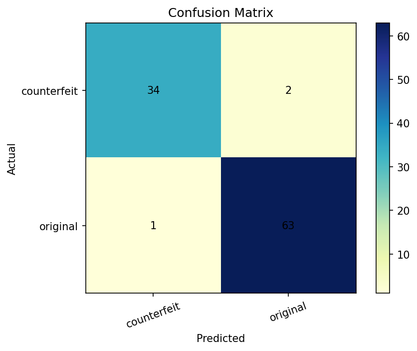
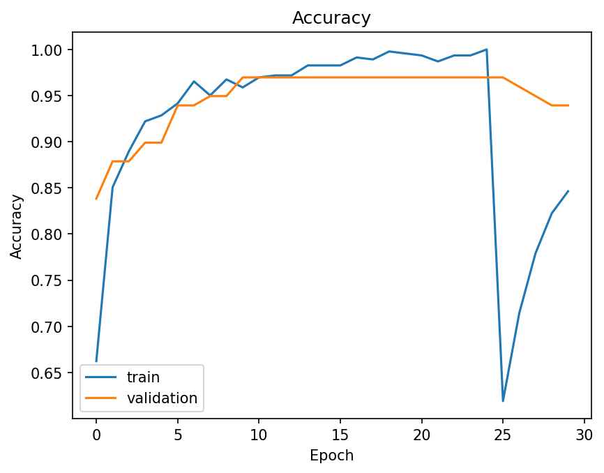
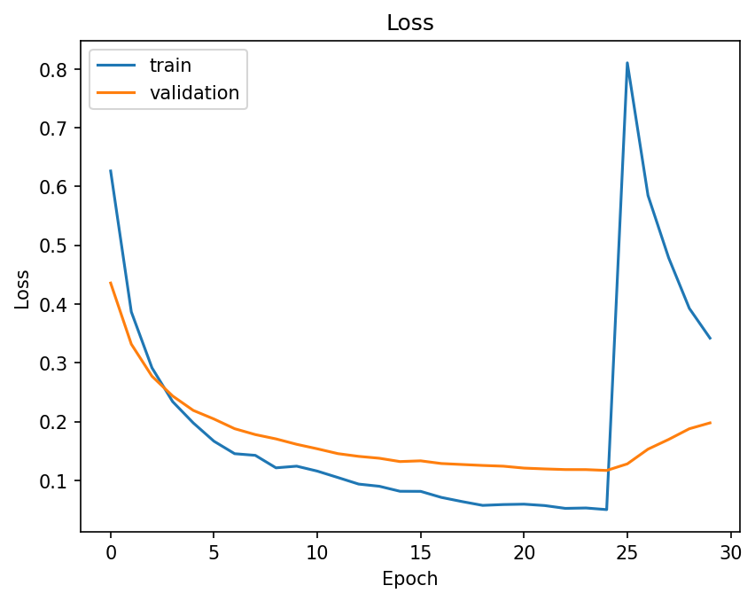
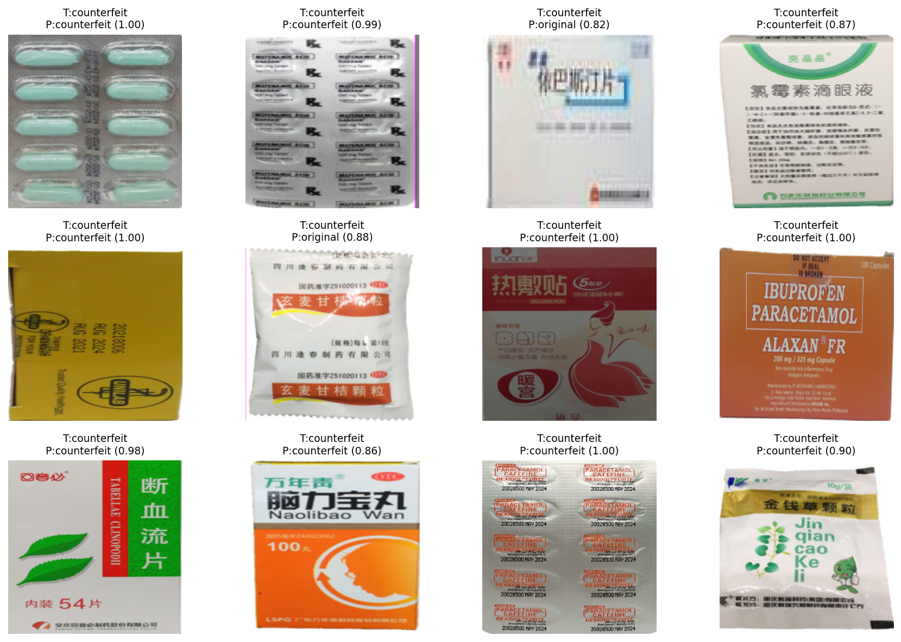

# 💊 Smart Drug Recognition System

### AI-Powered Medicine Packaging Image Classification

**A Deep Learning & Computer Vision Project Using MobileNetV2, TensorFlow, Keras, and Streamlit**

Developed as a collaborative academic project at **Istanbul Arel University**.

**Repository maintained by Ahmed Abdelmoula**

---

## 📌 Project Overview

The **Smart Drug Recognition System** is an academic deep-learning application designed to classify images of medicine packaging into two categories:

- ✅ **Original**
- 🔍 **Counterfeit**

The system uses a **MobileNetV2-based Convolutional Neural Network (CNN)** with transfer learning to identify visual patterns learned from labeled medicine-package images.

An interactive **Streamlit dashboard** allows users to upload an image, explore the model's prediction, and review recorded performance metrics.

> ⚠️ **Research Disclaimer:** This is an educational image-classification project, not a certified pharmaceutical authentication system. Predictions cannot establish whether a medicine is genuine, safe, effective, or suitable for use.

---

## ✨ Key Features

| Feature | Description |
|---|---|
| 🧠 Deep Learning | MobileNetV2-based CNN with transfer learning |
| 🖼️ Image Classification | Classifies packaging images into Original or Counterfeit |
| 💻 Interactive Dashboard | Streamlit web interface with three sections |
| 📊 Performance Analysis | Accuracy, loss plots, confusion matrix, and classification report |
| 🔄 Image Preprocessing | RGB conversion and image resizing |
| 💾 Saved AI Model | Reusable `.keras` model for inference |
| 📁 Project Documentation | Academic report and presentation |
| 🧪 Automated Tests | Tests for preprocessing, score validation, and class mapping |

---

## 📊 Model Performance

The following results were recorded during the original project's evaluation.

| Metric | Recorded Result |
|---|---:|
| Test Accuracy | **97.00%** |
| Correct Predictions | **97 / 100** |
| Test Images | 100 |
| Original Images | 64 |
| Counterfeit Images | 36 |
| Test Loss | 0.0833 |

### Confusion Matrix



Recorded confusion matrix:

```text
                    Predicted
                  Counterfeit  Original

Actual Counterfeit     34         2
Actual Original         1        63
```

### Training Accuracy



### Training and Validation Loss



**Evaluation note:** These figures come from the saved project results. They have not been independently reproduced, and performance on unseen medicine products or different image conditions is unknown.

---

## 🖥️ Interactive AI Dashboard

The application provides three main sections.

### 1. 🔬 Prediction

Upload a medicine-package image and explore the trained model's output.

Features include:

- Image upload (JPG, PNG, JPEG, and WEBP)
- Uploaded image preview
- Image dimensions and file information
- Original / Counterfeit classification
- Model output scores
- Technical prediction details
- Image-processing workflow

### 2. 📊 Model Performance

Explore the recorded evaluation results:

- Test accuracy
- Number of evaluated images
- Correct classifications
- Confusion matrix
- Training and validation accuracy
- Training and validation loss
- Classification report
- Dataset summary

### 3. 📘 About Project

Explore the technologies and research workflow behind the project:

- Project overview
- Technology stack
- Processing pipeline
- Research limitations
- Academic report and presentation
- Saved prediction visualizations

### Example Prediction Visualizations



*Saved example visualizations from the original team project.*

---

## 🏗️ System Architecture

The application follows this workflow:

```text
              MEDICINE PACKAGE IMAGE
                         |
                         v
                  IMAGE UPLOAD
                         |
                         v
                 PREPROCESSING
                 - RGB conversion
                 - Image resizing
                         |
                         v
               MOBILENETV2-BASED CNN
                         |
                         v
                 BINARY CLASSIFIER
                         |
               +---------+---------+
               |                   |
               v                   v
            ORIGINAL          COUNTERFEIT
               |                   |
               +---------+---------+
                         |
                         v
                 STREAMLIT DASHBOARD
                 - Predicted class
                 - Model output score
```

### Deep Learning Architecture

The model uses **MobileNetV2**, a convolutional neural network originally developed for efficient visual feature extraction.

The project applies transfer learning using ImageNet-pretrained weights and includes training and fine-tuning code.

The saved trained model is loaded for inference without requiring retraining.

---

## 🛠️ Technology Stack

| Technology | Purpose |
|---|---|
| Python 3.11 | Recommended development environment |
| TensorFlow | Deep learning framework |
| Keras | Neural network training and inference |
| MobileNetV2 | CNN feature extraction architecture |
| NumPy | Numerical and image-array processing |
| Pillow | Image loading and conversion |
| Streamlit | Interactive web dashboard |
| Matplotlib | Training and evaluation visualizations |
| Scikit-learn | Model evaluation utilities |
| Git & GitHub | Version control and source hosting |

---

## 📁 Project Structure

```text
Smart-Drug-Recognition-System/
|
|-- docs/
|   |-- LEEN364__Smart_Drug_Recognition.pdf
|   |-- PRESENTATION_Smart_Drug_Recogniton.pdf
|
|-- interface/
|   |-- __init__.py
|   |-- app_ui.py
|   |-- inference.py
|
|-- models/
|   |-- smart_drug_model.keras
|
|-- results/
|   |-- accuracy_loss_plots/
|   |-- confusion_matrix/
|   |-- dataset_summary/
|   |-- sample_predictions/
|   |-- training_history.json
|
|-- scripts/
|   |-- check_project.py
|
|-- src/
|   |-- config.py
|   |-- data_preprocessing/
|   |-- training/
|   |-- evaluation/
|
|-- tests/
|   |-- test_inference.py
|
|-- .gitignore
|-- README.md
|-- requirements.txt
|-- requirements-demo.txt
```

---

## 🚀 Installation and Setup

### Prerequisites

- Python 3.11
- Git
- Internet access for installing dependencies
- Sufficient available disk space
- Windows, Linux, or macOS with compatible dependencies

The application has been run successfully on Windows using Python 3.11.9 and TensorFlow 2.19.1.

### Step 1 — Clone the Repository

```bash
git clone https://github.com/AhmedBahgat-22/Smart-Drug-Recognition-System.git
cd Smart-Drug-Recognition-System
```

### Step 2 — Create a Virtual Environment

```bash
python -m venv .venv
```

**Windows PowerShell:**

```powershell
.\.venv\Scripts\Activate.ps1
```

**Linux / macOS:**

```bash
source .venv/bin/activate
```

### Step 3 — Install Dependencies

```bash
python -m pip install -r requirements-demo.txt
```

> Installation note: TensorFlow is a large dependency. Ensure sufficient free disk space. A clean installation attempt on the development computer was interrupted by a full disk and has not yet been successfully repeated.

### Step 4 — Verify Project Files

```bash
python scripts/check_project.py
```

### Step 5 — Launch the Application

```bash
python -m streamlit run interface/app_ui.py
```

Open the local URL displayed in your terminal, typically:

**http://localhost:8501**

### Step 6 — Try a Prediction

1. Open the Prediction section.
2. Upload a supported medicine-package image.
3. Preview the uploaded image.
4. Review the predicted class and model scores.
5. Explore the Performance and About Project sections.

**Important:** A model score represents the classifier's output, not a validated probability that a medicine is authentic.

---

## 🧪 Testing and Quality Assurance

The project includes automated unit tests.

### Run the Tests

```bash
python -m unittest discover -s tests -v
```

### Additional Checks

```bash
python scripts/check_project.py
python -m compileall -q interface src tests scripts
```

### Verified Test Results

The following four tests passed on Windows with Python 3.11.9:

| Test | Result |
|---|---|
| Class label mapping | PASSED |
| Image preprocessing shape and range | PASSED |
| Invalid prediction score rejection | PASSED |
| RGBA image handling | PASSED |

**Result: 4 / 4 tests passed.**

The project was also launched through Streamlit and used for image inference on the developer's computer. A GitHub-cloned copy was launched using the previously working Python environment.

Automated tests do not establish real-world pharmaceutical authenticity performance, and a fully independent clean-environment setup remains to be verified.

---

## 📦 Dataset Information

The team referenced the following dataset:

**[Fake vs Real Medicine Dataset — Kaggle](https://www.kaggle.com/datasets/surajkumarjha1/fake-vs-real-medicine-datasets-images)**

### Recorded Dataset Summary

| Category | Raw Images |
|---|---:|
| Original | 421 |
| Counterfeit | 240 |
| **Total** | **661** |

The original dataset and prepared training, validation, and test image folders are **not included** in the GitHub repository.

### Expected Raw Dataset Layout

```text
dataset/
    raw/
        original/
        counterfeit/
```

### Prepare the Dataset

After obtaining the dataset and placing its images in the expected folders:

```bash
python -m src.data_preprocessing.prepare_dataset --clean-processed --skip-corrupt
```

The dataset source, redistribution rights, and exact reproduction of the original split should be confirmed before retraining.

---

## 🧠 Model Training and Evaluation

The repository contains the source code used for data preparation, training, and evaluation.

### Train the Model

After preparing the dataset and installing the full dependencies from `requirements.txt`:

```bash
python -m src.training.train_model
```

### Evaluate the Model

```bash
python -m src.evaluation.evaluate_model
```

> **Note:** Retraining may overwrite existing model files or evaluation outputs. Preserve backups before running training or evaluation scripts.

The included `.keras` model can be used by the Streamlit application without retraining.

---

## 📄 Academic Documentation

The original academic documents are included:

- **[Project Report (PDF)](docs/LEEN364__Smart_Drug_Recognition.pdf)**
- **[Project Presentation (PDF)](docs/PRESENTATION_Smart_Drug_Recogniton.pdf)**

These files are retained from the collaborative team project. Original authorship and contributions should be acknowledged appropriately.

---

## ⚠️ Limitations

This system has several important research limitations:

1. Historical test accuracy is based on a limited dataset.
2. Performance on new medicine brands and packaging designs is not established.
3. Lighting, image resolution, camera angle, and background may influence predictions.
4. The model cannot inspect pharmaceutical ingredients or manufacturing records.
5. Model output scores are not calibrated authenticity probabilities.
6. The training dataset is not distributed with the repository.
7. Full clean-environment installation and training reproducibility remain unverified.

**The system must not be used as a substitute for pharmacists, manufacturers, or official medicine-verification procedures.**

---

## 🔮 Future Improvements

Potential future developments include:

- Evaluating the model on independently collected medicine-package images
- Increasing dataset diversity and class balance
- Improving generalization to different lighting and image conditions
- Investigating explainability methods such as Grad-CAM
- Adding more detailed model evaluation and error analysis
- Improving the interactive dashboard
- Testing clean installation across supported environments
- Publishing an optional hosted research demonstration
- Documenting reproducible dataset splits and training settings

These are proposed improvements, not existing implemented capabilities.

---

## 👨‍💻 Project Credits

**Smart Drug Recognition System** was developed collaboratively as an academic team project.

**GitHub Repository Owner / Team Contributor:** Ahmed Abdelmoula

**University:** Istanbul Arel University  
**Faculty:** Faculty of Engineering  
**Course:** LEEN364 — Deep Learning and Classification Techniques

This repository is maintained by Ahmed Abdelmoula as a personal GitHub copy of the shared team project.

The source code, trained model, evaluation artifacts, and original documentation are collaborative work. Repository ownership does not imply exclusive authorship.

Additional team member names and individual contributions may be documented after confirmation.

---

## 📬 Repository

**GitHub:** [AhmedBahgat-22 / Smart-Drug-Recognition-System](https://github.com/AhmedBahgat-22/Smart-Drug-Recognition-System)

---

### ⭐ Smart Drug Recognition System

*Exploring deep learning, computer vision, and medicine-packaging image classification through academic research.*
