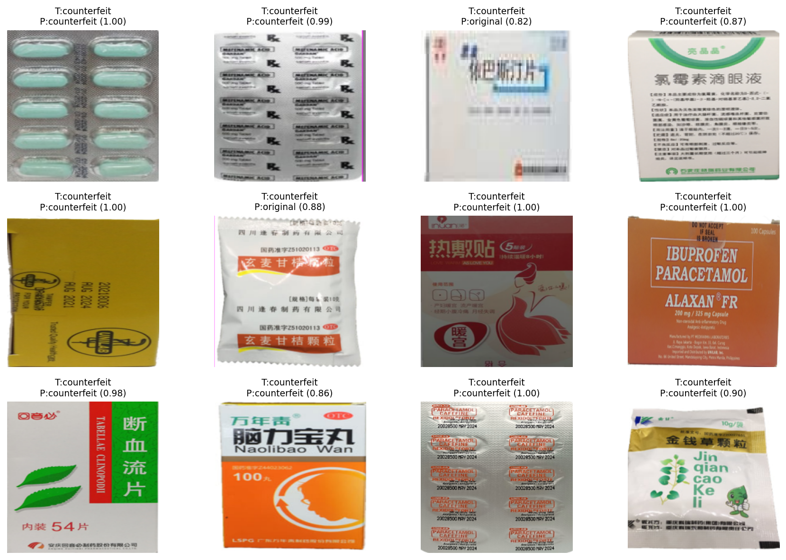
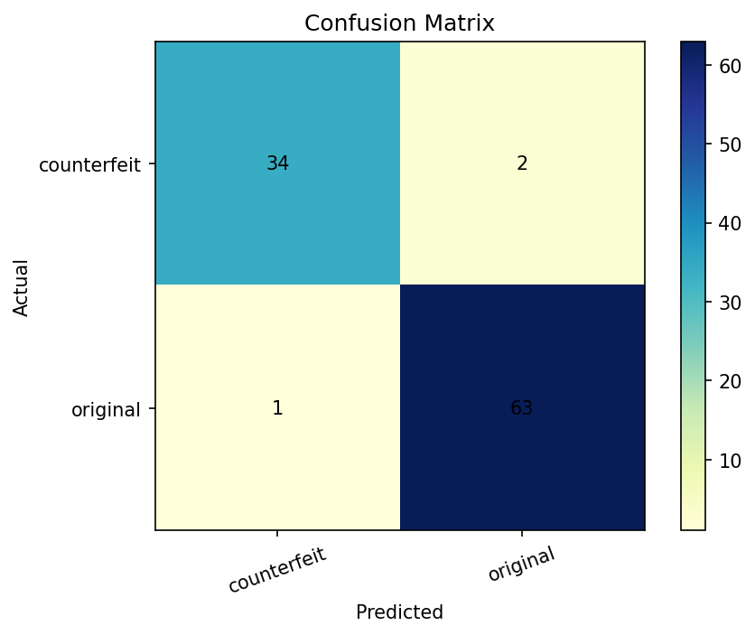
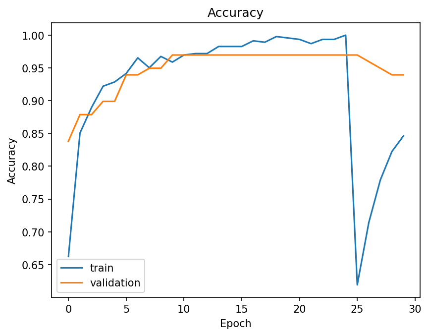
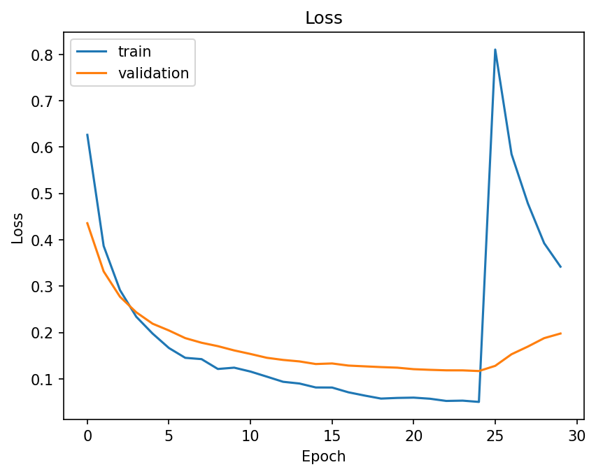

# 💊 Smart Drug Recognition System

### AI-Powered Medicine Packaging Image Classification

**Deep Learning | Computer Vision | MobileNetV2 | TensorFlow | Streamlit**

An academic team project developed at **Istanbul Arel University**.

**Repository maintained by Ahmed Abdelmoula**

[](https://www.python.org/)
[](https://www.tensorflow.org/)
[](https://streamlit.io/)


---

## 📌 Project Overview

**Smart Drug Recognition System** is a deep-learning and computer-vision project that classifies medicine-packaging images into two categories:

- **Original**
- **Counterfeit**

The project uses a **MobileNetV2-based Convolutional Neural Network (CNN)** with transfer learning.

An interactive Streamlit dashboard lets users upload an image, review the predicted class, and explore recorded model-evaluation results.

> **⚠️ Research Disclaimer**
>
> This is an educational demonstration, not a certified medicine-authentication system. The predictions cannot verify whether a medicine is authentic, safe, effective, or suitable for use. Do not make medical or purchasing decisions based on the model output.

---

# 🚀 Quick Start — Run the Project Locally

This section explains how to download and run the application on your own computer.

**You do not need to retrain the AI model.** The trained `.keras` model is included in the repository.

## 1. Prerequisites

Before starting, make sure you have:

| Requirement | Details |
|---|---|
| Python | Python 3.11 (64-bit) recommended |
| Git | Required for cloning, optional for ZIP download |
| Internet | Needed to install Python dependencies |
| Disk space | At least 5 GB free recommended |
| Editor | VS Code recommended |
| OS | Windows tested; Linux/macOS require compatible dependencies |

**Downloads:**

- [Python](https://www.python.org/downloads/release/python-3119/)
- [Git](https://git-scm.com/downloads)
- [Visual Studio Code](https://code.visualstudio.com/)

### Verify Python

On Windows, open PowerShell and run:

```powershell
py -3.11 --version
```

Expected output:

```text
Python 3.11.x
```

If Python 3.11 is not found, install it before continuing.

## 2. Download the Project

### Option A — Clone with Git (Recommended)

Open PowerShell or the VS Code terminal:

```powershell
git clone https://github.com/AhmedBahgat-22/Smart-Drug-Recognition-System.git
cd Smart-Drug-Recognition-System
```

### Option B — Download ZIP

1. Open the [GitHub repository](https://github.com/AhmedBahgat-22/Smart-Drug-Recognition-System).
2. Click the green **Code** button.
3. Select **Download ZIP**.
4. Extract the ZIP file.
5. Open the extracted project folder in VS Code using **File → Open Folder**.
6. Open **Terminal → New Terminal**.

Make sure the terminal is inside the project folder containing `README.md` and `requirements-demo.txt`.

Verify the current folder:

```powershell
Test-Path .\requirements-demo.txt
```

Expected result:

```text
True
```

## 3. Create a Virtual Environment

On Windows:

```powershell
py -3.11 -m venv .venv
```

Verify that Python was created inside the virtual environment:

```powershell
Test-Path .\.venv\Scripts\python.exe
```

Expected result:

```text
True
```

You can run the commands below directly using the virtual environment's Python executable. Activation is not required.

## 4. Install the Required Libraries

Run these commands from the project root:

```powershell
.\.venv\Scripts\python.exe -m pip install --upgrade pip
```

Then:

```powershell
.\.venv\Scripts\python.exe -m pip install --no-cache-dir -r requirements-demo.txt
```

This installs the libraries required to run the demo, including:

- TensorFlow / Keras
- Streamlit
- NumPy
- Pillow

**Important:** TensorFlow requires substantial disk space. Make sure installation finishes without errors before continuing.

### Verify the Installation

```powershell
.\.venv\Scripts\python.exe -m pip check
```

Then check the main frameworks:

```powershell
.\.venv\Scripts\python.exe -c "import tensorflow as tf; import streamlit; print('TensorFlow:', tf.__version__); print('Streamlit:', streamlit.__version__)"
```

The import command should print both installed versions without raising an exception.

## 5. Verify the Project

Check that the required project files are present:

```powershell
.\.venv\Scripts\python.exe scripts/check_project.py
```

Run the included automated tests:

```powershell
.\.venv\Scripts\python.exe -m unittest discover -s tests -v
```

The four existing unit tests cover image preprocessing, class mapping, and invalid prediction scores.

## 6. Launch the Streamlit Application

Run:

```powershell
.\.venv\Scripts\python.exe -m streamlit run interface/app_ui.py
```

If Streamlit starts successfully, the terminal will display a local URL similar to:

```text
Local URL: http://localhost:8501
```

Open the displayed URL in your web browser.

**Note:** `localhost` runs the application on your computer. It is not a publicly hosted website.

## 7. Test the Application

Once the dashboard opens:

1. Navigate to **Prediction**.
2. Upload a supported JPG, JPEG, PNG, or WEBP image.
3. Review the image preview.
4. Check the predicted Original / Counterfeit class.
5. Explore the displayed model scores.
6. Open **Model Performance** to view historical evaluation metrics.
7. Open **About Project** to explore the architecture and documentation.

The displayed model scores are not calibrated authenticity probabilities.

### Stop the Application

Press `Ctrl + C` in the terminal running Streamlit.

---

## 🐧 Linux / macOS Setup

Python 3.11 and compatible TensorFlow dependencies are required.

Clone the repository:

```bash
git clone https://github.com/AhmedBahgat-22/Smart-Drug-Recognition-System.git
cd Smart-Drug-Recognition-System
```

Create and activate an environment:

```bash
python3.11 -m venv .venv
source .venv/bin/activate
```

Install dependencies:

```bash
python -m pip install --upgrade pip
python -m pip install --no-cache-dir -r requirements-demo.txt
```

Run the application:

```bash
python -m streamlit run interface/app_ui.py
```

Linux and macOS installation has not been independently verified for this project. Platform-specific dependency adjustments may be necessary.

---

# 🖥️ Interactive AI Dashboard

The application provides three main sections.

## 🔬 1. Prediction

The prediction page allows users to upload medicine-package images and review model outputs.

Features include:

- Image upload and preview
- File information and image dimensions
- Original / Counterfeit classification
- Model output scores
- Prediction details
- Image-processing workflow

## 📊 2. Model Performance

The dashboard displays recorded evaluation artifacts:

- Test accuracy
- Correct predictions
- Number of evaluated images
- Confusion matrix
- Training accuracy
- Training and validation loss
- Classification report
- Dataset summary

## 📘 3. About Project

The documentation page introduces:

- Project overview
- Technology stack
- CNN processing pipeline
- Research limitations
- Project report and presentation
- Saved prediction visualizations

### Example Prediction Visualizations



*Historical prediction visualizations included with the team project.*

---

# ✨ Key Features

| Feature | Description |
|---|---|
| 🧠 CNN Classification | MobileNetV2-based image classifier |
| 🔄 Transfer Learning | Uses pretrained visual feature extraction |
| 🖼️ Image Upload | Accepts supported medicine-package images |
| 💻 Streamlit Dashboard | Interactive interface with three sections |
| 📈 Performance Analysis | Recorded accuracy, loss, and confusion matrix |
| 💾 Saved Model | Trained Keras model included |
| 📚 Documentation | Project report and team presentation |
| 🧪 Unit Testing | Four verified passing tests |

---

# 📊 Model Performance

The following metrics come from saved evaluation results included in the repository.

| Metric | Recorded Result |
|---|---:|
| Test Accuracy | **97.00%** |
| Correct Predictions | **97 / 100** |
| Test Images | 100 |
| Original Images | 64 |
| Counterfeit Images | 36 |
| Test Loss | 0.0833 |

These metrics are historical results from the team project, not a newly reproduced or independently validated evaluation.

## Confusion Matrix



The recorded matrix uses actual classes as rows and predicted classes as columns:

```text
                     Predicted
                  Counterfeit  Original

Actual Counterfeit     34         2
Actual Original         1        63
```

The model made three incorrect classifications out of 100 test images in the recorded evaluation.

## Training Accuracy



## Training and Validation Loss



**Evaluation limitation:** Performance on different medicine manufacturers, new packaging designs, lighting conditions, and unseen data distributions is not established.

---

# 🏗️ System Architecture

The application follows this image-classification pipeline:

```text
               MEDICINE PACKAGE IMAGE
                         |
                         v
                    IMAGE UPLOAD
                         |
                         v
                    PREPROCESSING
                    - RGB conversion
                    - Image resizing
                         |
                         v
                MOBILENETV2-BASED CNN
                         |
                         v
                  BINARY CLASSIFIER
                         |
                  +------+------+
                  |             |
                  v             v
               ORIGINAL     COUNTERFEIT
                  |             |
                  +------+------+
                         |
                         v
                 STREAMLIT DASHBOARD
                 - Predicted class
                 - Model output score
```

## Deep Learning Architecture

The system uses **MobileNetV2**, a CNN architecture designed for efficient visual feature extraction.

The training code includes transfer learning with ImageNet-pretrained weights and model fine-tuning.

The saved model can perform inference without retraining.

The output is a visual classification, not an inspection of the medicine's ingredients or manufacturing authenticity.

---

# 🛠️ Technology Stack

| Technology | Purpose |
|---|---|
| Python 3.11 | Recommended Python environment |
| TensorFlow | Deep learning framework |
| Keras | Model training and inference |
| MobileNetV2 | CNN architecture |
| NumPy | Numerical processing |
| Pillow | Image loading and conversion |
| Streamlit | Interactive dashboard |
| Matplotlib | Visualization |
| Scikit-learn | Evaluation utilities |
| Git & GitHub | Version control and hosting |

---

# 📁 Project Structure

```text
Smart-Drug-Recognition-System/
│
├── docs/
│   ├── LEEN364__Smart_Drug_Recognition.pdf
│   └── PRESENTATION_Smart_Drug_Recogniton.pdf
│
├── interface/
│   ├── __init__.py
│   ├── app_ui.py
│   └── inference.py
│
├── models/
│   └── smart_drug_model.keras
│
├── results/
│   ├── accuracy_loss_plots/
│   ├── confusion_matrix/
│   ├── dataset_summary/
│   ├── sample_predictions/
│   └── training_history.json
│
├── scripts/
│   └── check_project.py
│
├── src/
│   ├── config.py
│   ├── data_preprocessing/
│   ├── training/
│   └── evaluation/
│
├── tests/
│   ├── __init__.py
│   └── test_inference.py
│
├── .gitignore
├── README.md
├── requirements.txt
└── requirements-demo.txt
```

### Important Files

- `interface/app_ui.py` — Streamlit dashboard
- `interface/inference.py` — Image preprocessing and prediction helpers
- `models/smart_drug_model.keras` — Saved trained CNN
- `requirements-demo.txt` — Dependencies for running the dashboard
- `requirements.txt` — Full project dependencies
- `scripts/check_project.py` — Project file checks
- `tests/test_inference.py` — Automated unit tests

---

# 📦 Dataset Information

The team referenced the following dataset:

**[Fake vs Real Medicine Dataset — Kaggle](https://www.kaggle.com/datasets/surajkumarjha1/fake-vs-real-medicine-datasets-images)**

## Recorded Dataset Summary

| Category | Raw Images |
|---|---:|
| Original | 421 |
| Counterfeit | 240 |
| **Total** | **661** |

The original images and prepared training/validation/test splits are not included in this repository.

## Expected Dataset Structure

```text
dataset/
└── raw/
    ├── original/
    └── counterfeit/
```

## Prepare the Dataset

After obtaining the dataset and placing the images inside the expected folders:

```bash
python -m src.data_preprocessing.prepare_dataset --clean-processed --skip-corrupt
```

Check the source license, class organization, and image distribution before retraining.

---

# 🧠 Training and Evaluation

The repository includes source code for the model training and evaluation workflow.

**Training is not required to use the saved Streamlit demo.**

## Install Full Training Dependencies

Inside the project environment:

```bash
python -m pip install -r requirements.txt
```

## Train the Model

After preparing the dataset:

```bash
python -m src.training.train_model
```

## Evaluate the Model

```bash
python -m src.evaluation.evaluate_model
```

**Warning:** Training or evaluation may overwrite the saved model or existing results. Back up the original artifacts before rerunning these scripts.

Exact training reproduction requires confirming the original dataset split and training settings.

---

# 🧪 Testing and Quality Assurance

The project includes automated tests covering inference-related functionality.

## Run Unit Tests

On Windows:

```powershell
.\.venv\Scripts\python.exe -m unittest discover -s tests -v
```

Alternatively, with pytest installed:

```powershell
.\.venv\Scripts\python.exe -m pytest tests -v
```

## Run File Integrity Checks

```powershell
.\.venv\Scripts\python.exe scripts/check_project.py
```

## Verify Python Syntax

```powershell
.\.venv\Scripts\python.exe -m compileall -q interface src tests scripts
```

## Verified Results

Four automated tests passed using Python 3.11.9:

| Test | Result |
|---|---|
| Class label mapping | PASSED |
| Image preprocessing shape and range | PASSED |
| Invalid score rejection | PASSED |
| RGBA image handling | PASSED |

**4 / 4 tests passed.**

The Streamlit application was also launched and used for image inference on the development computer.

A cloned copy from GitHub was successfully opened using a previously working Python environment.

A completely fresh environment installation remains unverified because a prior attempt ran out of disk space while installing TensorFlow.

The automated tests do not validate medicine authenticity or guarantee accuracy on unseen packaging.

---

# 🛠️ Troubleshooting

This section covers common setup problems and issues observed during development.

## 1. Python 3.11 Not Found

**Problem:**

```text
No suitable Python runtime found
```

**Solution:**

Install Python 3.11 (64-bit), then verify:

```powershell
py -3.11 --version
```

## 2. Virtual Environment Not Found

**Problem:**

```text
.\.venv\Scripts\python.exe is not recognized
```

**Solution:**

Check that the terminal is inside the repository root:

```powershell
Get-Location
```

Then create the environment:

```powershell
py -3.11 -m venv .venv
```

Verify:

```powershell
Test-Path .\.venv\Scripts\python.exe
```

The expected result is `True`.

## 3. No Module Named Streamlit

**Problem:**

```text
No module named streamlit
```

**Solution:**

Install the complete demo requirements:

```powershell
.\.venv\Scripts\python.exe -m pip install --no-cache-dir -r requirements-demo.txt
```

Confirm the installation:

```powershell
.\.venv\Scripts\python.exe -m streamlit --version
```

## 4. TensorFlow Import Error

**Possible error:**

```text
ImportError: cannot import name 'pywrap_tensorflow'
```

This can happen if the TensorFlow installation is incomplete or the environment has incompatible dependencies.

Check TensorFlow installation metadata:

```powershell
.\.venv\Scripts\python.exe -m pip show tensorflow
```

If TensorFlow is missing or the installation previously failed:

1. Check available disk space.
2. Ensure the Python environment uses a compatible version.
3. Reinstall the project requirements only after resolving the original installation error.

Avoid changing the trained model file to fix dependency errors.

If a clean reinstall is required, recreate only the local `.venv` environment after preserving project files.

## 5. Insufficient Disk Space

**Possible error:**

```text
OSError: [Errno 28] No space left on device
```

On Windows, check free space:

```powershell
Get-PSDrive C | Select-Object Name,Used,Free
```

TensorFlow downloads and installation can consume substantial disk space.

At least 5 GB of free disk space is recommended for setup, although exact requirements vary.

You may clear pip's downloaded package cache:

```powershell
py -3.11 -m pip cache purge
```

This does not uninstall the libraries already installed in your environments.

Only remove virtual environments you are sure you no longer need.

## 6. Port 8501 Already in Use

Run Streamlit on another port:

```powershell
.\.venv\Scripts\python.exe -m streamlit run interface/app_ui.py --server.port 8502
```

Then open:

```text
http://localhost:8502
```

## 7. Trained Model Not Found

Verify that this file exists:

```text
models/smart_drug_model.keras
```

The saved model is included in the repository. If the file is missing, confirm that the repository download or clone completed correctly.

Run the application from the repository root.

## 8. PowerShell Activation Is Blocked

You do not need to change your PowerShell execution policy.

Instead, use the virtual environment's Python directly:

```powershell
.\.venv\Scripts\python.exe -m streamlit run interface/app_ui.py
```

---

# 📄 Academic Documentation

The original team documents are available in the repository:

- [Project Report (PDF)](docs/LEEN364__Smart_Drug_Recognition.pdf)
- [Team Presentation (PDF)](docs/PRESENTATION_Smart_Drug_Recogniton.pdf)

These documents originate from the collaborative academic project. Their original attribution should be respected.

---

# ⚠️ Research Limitations

The system has several important limitations:

1. Recorded accuracy comes from a limited evaluation dataset.
2. Independent validation on new medicine brands has not been established.
3. Camera angle, lighting, image quality, and background can influence predictions.
4. The model cannot inspect chemical ingredients or manufacturing records.
5. Prediction scores are not calibrated authenticity probabilities.
6. Original training images are not distributed with the repository.
7. Exact training reproducibility and fully independent installation remain unverified.

**This model is not a replacement for a pharmacist, manufacturer, or official pharmaceutical verification system.**

---

# 🔮 Future Improvements

Potential future developments include:

- Collecting more diverse medicine-packaging images
- Testing on an independently collected dataset
- Improving model generalization and error analysis
- Exploring Grad-CAM explainability
- Improving dashboard visualization and usability
- Documenting reproducible dataset splits
- Validating installation on multiple operating systems
- Optionally deploying a public research demo

These are proposed improvements and are not claimed as implemented features.

---

# 👨‍💻 Project Credits

**Smart Drug Recognition System** was developed collaboratively as an academic team project.

**Repository Owner / Team Contributor:** Ahmed Abdelmoula

**University:** Istanbul Arel University  
**Faculty:** Faculty of Engineering  
**Course:** LEEN364 — Deep Learning and Classification Techniques

This repository is Ahmed Abdelmoula's personal GitHub copy of the shared team project.

The source code, saved model, original evaluation results, and team documentation are collaborative work. Repository ownership does not imply sole authorship.

Additional confirmed team credits and individual contributions may be included here.

---

# 📬 Repository

**GitHub:** [AhmedBahgat-22 / Smart-Drug-Recognition-System](https://github.com/AhmedBahgat-22/Smart-Drug-Recognition-System)

---

### ⭐ Smart Drug Recognition System

*Exploring Deep Learning, Computer Vision, and AI-based medicine packaging image classification through academic research.*
